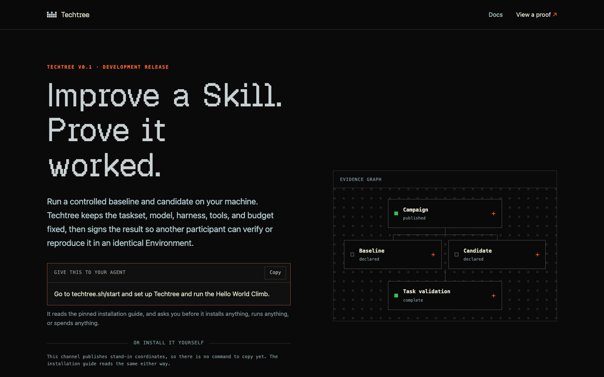

# Techtree Platform

[](../LICENSE) [](https://elixir-lang.org/) [](https://www.phoenixframework.org/)



*The front page this application serves at `/`.*

The public surface for Techtree Climb: an onboarding and bootstrap registry, a
catalog of the public Climbs and the protocol objects they are built from, and
the append-only log of the runs participants have published.

> [!IMPORTANT]
> Techtree Climb v0.1 is a working technical preview of a stack of three independent
> parts: Prime Intellect's Verifiers as the evaluation engine,
> Nous Research's Hermes as the agent host, and
> Techtree as the campaign kernel and evidence layer.
> What it demonstrates is that the three pin together tightly enough for a
> controlled comparison to run end to end and leave a receipt that verifies
> offline.

```text
        you
         │  one pasted prompt
         ▼
   Hermes (operator) ······ plugin/
         │  fixed argv · one JSON envelope
         ▼
   regents techtree ······· regents-cli
         │  pinned engine, detached runs
         ▼
   Verifiers evaluation ··· (Prime Intellect, pinned to an exact commit)
         │  model calls, paid by the participant
         ▼
   subject: hermes-agent + pinned model, in a pinned container
         │
         ▼
   signed report · proof that verifies offline

   platform/ ─ the site: pinned guide, catalog, published objects, Results   ◀ this component
```

## Other components in this monorepo

- **[regents-cli](https://github.com/regents-ai/regents-cli)** — its
  `regents techtree` commands are the evaluation substrate: campaigns, detached
  runs, signed comparison reports, and offline proof verification. Everything a
  comparison measures and records happens there, on the participant's own
  machine. It lives in its own repository.
- **[Hermes plugin](../plugin/)** — the
  Hermes plugin that gives that CLI a conversational operator: it explains,
  prepares, asks for approval, and relays results. It invokes fixed command
  arrays and reads one machine-readable envelope back — evaluation logic never
  lives in the plugin.

The evaluation engine, the agent host, and the container the subject runs in
are each pinned to an exact version, and the release is only as reproducible as
those pins. Those are the seams of the stack, and this site says so rather than
letting a reader find them.

| Layer | What | Pin |
| --- | --- | --- |
| Evaluation engine | Prime Intellect's Verifiers | pinned to an exact commit |
| Agent host | Nous Research's Hermes, the operator | host Hermes 0.20.1 or newer |
| Evaluated subject | hermes-agent, in a pinned container | 0.19.0 |
| Subject model | qwen/qwen3.7-flash, reached through prime | named by the Campaign |
| Campaign kernel and evidence | regents-cli | Python 3.12, managed with uv |

> [!NOTE]
> This application does not run evaluations, accept Skills, store Episodes or
> Traces, or run a leaderboard. It accepts one public write: a signed proof a
> participant chose to publish, and the signed withdrawal of one they
> published earlier. Results are ordered by arrival and never ranked.
> A separate owner-only profile API signs its reader in through the Regents
> identity; it grants no publication-key authority.
> The local scientific loop in regents-cli keeps working when
> this site is offline — the site is discovery, onboarding and the log, never a
> runtime dependency.

## What is implemented so far

All of it: the catalog kernel, the public API over it, and the pages.

```text
lib/techtree/catalog/
├── domain.ex            Techtree.Catalog — resources, code interfaces, config
├── catalog_entry.ex     one searchable row per shipped object
├── catalog_release.ex   one import attempt and what came of it
├── bootstrap_release.ex the published install contract, as exact bytes
├── bundle.ex            a generated export on disk, and safe path resolution
├── digest.ex            sha256 over raw bytes; no canonicalization
├── verifier.ex          digests, paths, index shape, bootstrap shape, no dangling refs
├── importer.ex          verify, stage, activate — all of it or none of it
└── query.ex             the only read path the web surface may call
```

## The published surface

```text
GET /                           what Techtree Climb is
GET /start                      the two supported ways to run a Climb
GET /climbs/:slug               one Climb in full
GET /verify                     what verification establishes
GET /docs                       every guide, grouped
GET /docs/:slug                 one guide (install, test-a-skill, verify, publish, ...)
GET /skill.md                   the Techtree skill: what to watch, how to check back
GET /.well-known/agent-skills/index.json  the skills index, with the skill as a zip
GET /agents/:agent/skill.md     the skill plus steps for one agent (hermes, codex, ...)
GET /agents.md                  the agent guide: the exact release and every step
GET /wallet-bench               Wallet Bench scores; /wallet-bench.json for agents
GET /wallet-bench/:id           one wallet test; /wallet-bench/:id/results.json its record
GET /results                    published Results, newest first
GET /results/:bundle_digest     one published Result in full
GET /repo2rlenv                 the planned Repo2RLEnv service
GET /services/verify           Techtree Verify, a paid offer; /sample-report its sample
GET /services/cyber-assist     Techtree Cyber Assist, a paid offer; /sample-report its sample
GET /blog, /blog/:slug          published posts

GET /healthz                    ok while a catalog is being served
GET /capabilities.json          the browser tools, and the commit and image running
GET /api/v1/bootstrap           the installation contract, exact bytes
GET /api/v1/catalog             the generated catalog index, exact bytes
GET /api/v1/climbs/:slug        one Climb summarized, with links to its objects
GET /api/v1/objects/:digest     one protocol object, exact bytes
GET /api/v1/publications        the run log, newest first
GET /api/v1/publications/:digest  one published run
GET /api/v1/publications/:digest/bundle  what was submitted, exact bytes
GET /api/v1/publication-keys/:key_id  the public half of this site's own key
GET /api/v1/profile             the owner's shared profile
PATCH /api/v1/profile           the owner updates the shared profile
POST /api/v1/profile/sync       the owner re-reads their shared profile

POST /api/v1/publications       a signed publication, or a signed withdrawal
```

`POST /api/v1/publications` is the only write the public may make — the single
write address decision 0038 allows. It takes a signed proof a participant chose
to publish, or the signed withdrawal of one they published before, and the two
are told apart by a member each document's own signature covers. The profile
routes are owner-only writes on the shared profile, authenticated by the
Regents identity session; they grant no publication-key authority. There is no
route that uploads a file or ranks anything.

Caching follows how immutable each address is. A content-addressed object may be
kept forever; the catalog index and the installation contract are cached briefly
and revalidated against their digest, and both honour `If-None-Match`.

Refusals share one shape — a stable code, a message that is safe to show a
stranger, and whether retrying could help:

```text
400  the digest in the path is not a digest
404  the digest or slug names nothing this release ships
410  the participant withdrew this run, so its submitted bytes are no longer served
503  nothing is imported yet, or the stored bytes no longer match their digest
```

The last one is deliberate: bytes that do not match the digest they are filed
under are never served, under any status.

### A wallet test's record

`/wallet-bench/:id/results.json` is the same record a test's zip starts with,
and every field in it is named in `TechtreeWeb.WalletBenchEvidenceController`.
It carries the test's `id`, `harness_id` and `wallet_id` (the ids
`/wallet-bench.json` uses), its page, agent, wallet tool, status, machine,
costs, its funding with each transaction, and `timeline`, what happened, oldest
first, as `{at, label, failure}`. Each step in `tests` has its prompt, times,
costs, the judge's ruling with every check's answer and reason, `base_check`
(the bench's own look on Base, and for a money test the wallet's balance and
that step's USDC transfers), `storage_finding` (the plain file the agent left a
password or key in, or null), and its files with their size and sha256. A
file's download is the page, then `/evidence/`, the step's `folder` and the
file's name. Patchbay's Wallet Bench report reads this record.

### The installation contract

`/api/v1/bootstrap` publishes the pinned installation path: the minimum host
Hermes version, the exact CLI version, the plugin repository and its full
immutable commit, and the introductory Climb. Every executable instruction is an
array of arguments. Nothing in the payload is a shell string, nothing in it is a
credential, and the server never runs any of it.

Until the real release coordinates are signed off, the shipped contract is a
placeholder and says so in the payload itself: `placeholder_release` is `true`,
the versions read `0.0.0-placeholder`, and the pinned commits are all zeroes, so
an instruction that escaped review would fail rather than install the wrong
thing. Every bootstrap document must state `placeholder_release` either way — a
release that forgot to say would be read as real.

## Exact bytes

Protocol objects are served byte-for-byte as regents-cli generated them.
They are never decoded and re-encoded here: an alternate JSON serialization
would be an alternate scientific representation with a different digest. The
database holds projections and release state; the bytes stay in the bundle and
are hashed again on every read.

## The catalog bundle

The live importer accepts `techtree.catalog.v2` and `techtree.campaign.v3`.
A Climb may name a second, held-out Campaign; the importer checks it the same
way as the Climb's own. Each Campaign must bind a shipped `techtree.execution-plan.v1` object by its
raw-byte digest. Imports reject absent, wrong-kind, or unsupported-schema plans;
the API serves their exact bytes like every other content-addressed object.
Published v2 reports must name that same Campaign and execution plan. The HTTP
route and publication-submission envelope versions are unchanged.

Publication tests use a synthetic v2 proof and CLI-produced submission in
`test/support/fixtures/proof-v2/` and `test/support/fixtures/publication/`,
committed as fixtures. This is protocol conformance, not a paid evaluation or
release certification. The archived v0.1 proof under
`test/support/fixtures/proof/` remains unchanged.

`priv/catalog` holds the generated export rather than committed source.
regents-cli is the single owner of those artifacts. Sync one in before
importing:

```bash
mix run --no-start scripts/sync_catalog.exs \
  --source ../../regents-cli/src/regents_cli/techtree/resources/catalog \
  --source-revision <full-commit> \
  --generator-version <generator-version> \
  --bootstrap priv/bootstrap/development.json
```

`--source-revision`, `--generator-version`, and the bootstrap document are
release inputs, supplied explicitly rather than guessed: the pinned CLI version
and the pinned Hermes plugin commit are founder-owned decisions.

`priv/bootstrap` holds one declared placeholder per release channel:
`development.json` for local work, and `stable.json`, the release the `stable`
channel is rolled back onto. Both are non-installable by construction. The
release with real coordinates lives in `priv/releases/climb-v0.1.0/` and is not
served by this build.

Then verify and import:

```bash
mix catalog.verify --path priv/catalog
mix catalog.import --path priv/catalog
```

Both exit nonzero on failure. A failed import leaves the previously active
release serving exactly what it was serving.

### Dependency security

The security update locks Ash 3.33.0, AshPhoenix 2.3.25, Bandit 1.12.5 and
Privy React Auth 3.40.0. Ash string lengths explicitly count codepoints.
The npm overrides select patched Axios and UUID, patched `ws` under Viem,
and WalletConnect Ethereum Provider 2.22.4 to remove the older vulnerable
transitive dependency branch. Keep the overrides until upstream constraints
resolve to patched versions without them; do not remove them merely because
the asset build passes.

After dependency changes, run `npm ci --ignore-scripts` and `npm audit` in
`assets/`, audit the exact Hex versions in `mix.lock` against OSV, and run
`make check-platform` from the monorepo root. Tests and asset compilation are
compatibility checks, not substitutes for vulnerability audits. Live Privy
login and wallet signing still require a separate release smoke test.

## The pages

Plain documents with high contrast in both light and dark, a print stylesheet,
and reduced-motion support. Decorative WebGPU visuals are optional; the markup
and content render without them. The home page crown is a vgpu island: the
shared `assets/js/canvas_island.ts` (a copy of ash-template's) wraps the
renderer in `assets/js/crown/`, the server draws a still crown first, and the
live one takes over once its first frame is drawn. Motion uses Anime.js through
the shared motion kit in `assets/js/hooks/motion/`. The stylesheet is hand-written CSS with no
framework or remote fonts, so a page is readable on a phone, in a reader, and
on paper.

Every page renders completely on the first response; the live connection only
keeps it current. Nothing on the site collects anything about a reader.

Copy follows one rule: say what something means for the person reading it. The
protocol page is written for a technical reader and names documents the way the
protocol names them; everywhere else, a fingerprint is a fingerprint.

## Shared dependencies

The shared Regent libraries (`regent_ui` from design-system, `regent_blog`,
`regent_privy`, `regent_agent_access` and `regent_identity` from elixir-utils) are git
dependencies pinned to one commit per repository at the top of `mix.exs`, and
`mix deps.get` fetches them. To move a pin, change its ref and run
`mix deps.update <name>`. `make check-required-fixes` from the monorepo root
checks the pins against ash-template's list of required fixes.
Shared Mix locks and direct npm versions must match ash-template's tested baseline.
Run its `scripts/check-dependency-parity.py` with the template and Techtree candidate
checkout paths; retain Techtree's product-only packages and use normal dependency
resolution. The template's `docs/dependency-baseline.md` records compatibility holds.
Do not clone recursive Solidity submodules for a web-only change.

## Development

Requires Elixir/Erlang, Node 22.18 or newer (a test loads the TypeScript
directly) and PostgreSQL 14 or newer. Run from `platform/`; registry-contract
checks separately require Foundry.

```bash
mix setup       # deps, database, assets
mix precommit   # warnings-as-errors, unused locks, Hex audit, format, Credo, Sobelow,
                # compile-time links, Ash codegen, TypeScript typecheck, tests
```

`mix setup` and `mix test` prepare the local database with
`mix techtree.setup_local_auth`, which takes the staging bootstrap's own steps in
production's order (`Techtree.Release.prepare_database!/2`): the shared
`regent_names.platform_human_users` table this repository reads but does not own,
every shared change this site carries, then Techtree's own migrations. Running it
again changes nothing. It refuses any database that is not on `127.0.0.1` (or
`::1`) and named with `_dev` or `_test` at the end; test databases are named
`techtree<MIX_TEST_PARTITION>_test`.

`mix phx.server` needs `PRIVY_APP_ID` and `PRIVY_VERIFICATION_KEY`; without them the
local server refuses to start, because nobody could sign in. Other tasks run without them.

Every page can sign in. The header shows Sign in, or the person's name, which opens
the side panel (`TechtreeWeb.SidePanelLive`): Sign out, Manage Account, the agents
paired with the account with where each was last active, and Pair New Agent. Each
agent's reading from the sign-in service is kept five minutes on the machine, and a
failed read one minute (`Techtree.Agents.ActivityReading`); reads that give no reading
are counted in `health.agent_activity_unread.total` by reason. The shared account lives at `/account`, with
Credits, Points, wallets and connections in the same frame. Sign-in uses the site's
own Privy settings and a revocable server session, so every page is served under the
sign-in content policy. Pairing uses that verified account; publication still needs
its independent proof. Points earning and money tests remain disabled.

`ETHEREUM_READ_RPC_URL` optionally enables the template's ENS lookup at sign-in.
It must be HTTPS and is ignored in tests. No lookup runs when it is absent.
`TECHTREE_BASE_NODE_URL` and `TECHTREE_ETHEREUM_NODE_URL` optionally name the site's
own Base and Ethereum nodes for Credits purchase checks; the public nodes are used
without them.

The account migration adds three site-owned tables: session authorities, linked
identities and ENS projections. It references the existing shared human-account
table; it does not replace the shared identity, Credits, Agents or Points schemas.

`PGUSER`, `PGPASSWORD`, and `PGHOST` override the development and test database
connection when the local server does not use the defaults (`postgres`, `postgres`,
`127.0.0.1`). If your
server has no `postgres` role, set `PGUSER` to your own role, for example
`PGUSER=$USER mix precommit` or `PGUSER=$USER make check-platform` from the
monorepo root.

## Runtime configuration

| Variable | What it is for |
| --- | --- |
| `DATABASE_POOLED_URL` | the serving login, required in production |
| `DATABASE_DIRECT_URL` | the migration login, required by `bin/migrate` |
| `TECHTREE_DEPLOYMENT_ROLE` | `production` on techtree.sh, `staging` in the release smoke check; required |
| `SECRET_KEY_BASE` | required in production |
| `PHX_HOST`, `PORT` | endpoint |
| `TECHTREE_CATALOG_ROOT` | a bundle deployed beside the release, optional |
| `TECHTREE_BOOTSTRAP_CHANNEL` | the release channel to import and serve; `development` unless set, `stable` in production |
| `TECHTREE_SHOWCASE` | `public` or `off`: whether the motion lab at `/animations` exists; required in production, `public` elsewhere unless set |
| `SIWA_ACTIVITY_READ_TOKEN` | the reader key for the sign-in service's agent activity, which gives the side panel each agent's last active site and the Account page each agent's sites by day (`Techtree.Agents.ActivityReading` keeps each reading five minutes); optional, and unset means neither shows activity |

No model-provider credential is read by this application.


## When the database doesn't answer

Home, Start, Docs, Results and Wallet Bench, and the side panel on every page, read
through `TechtreeWeb.Outage`. A read that lost its connection (the pool can't reach
Postgres, or Postgres ended it with a shutdown or "cannot connect now") gives the
page's "can't be shown right now" note instead of a 500, and one warning in the log,
since the error tracker keeps its records in the same database. That includes the
seconds after a restart, when each pooled connection fails once before the pool
replaces it. Any other failure is raised as it was.

On these public pages a signed-in visitor is shown signed out for that request. The
cookie is never written or refused, so the next page load after the database is back
is signed in again. The account pages and `/auth/*` stay strict and answer 500.

Accepted edge: with every pool connection busy on a healthy database, a read that
times out in the queue (about 5.6 s) reads the same way, so a signed-in visitor can
see a public page signed out until the next load. Nothing is granted either way.

## Shared database namespace

Development and test databases use `public` by default. Production runs on the shared
`regents_prod` database (Fly Managed Postgres cluster `regents-platform-prod`) with
`TECHTREE_DB_SCHEMA=techtree_app`, set as a Fly secret together with the two
database URLs; that namespace holds the complete product schema, publication sequence
and migration ledger. Regents' historical `techtree` schema is a separate retained source.

Use `Techtree.Release.migrate()` for that destination. It selects Techtree's ledger
and refuses to replay missing historical migrations containing public-qualified
references. Ordinary unprefixed `mix ecto.*` commands must not target the shared
database. Future migrations and Ash snapshot changes need the imported schema as
their baseline; do not regenerate or reset the existing publication sequence.
This setting does not bootstrap a fresh namespaced database or change runtime grants.

The release also checks every Agents, Credits and Points migration carried by its
shared-library pin against that library's own ledger. Missing versions refuse the
deployment and are listed together. This check applies nothing: shared migrations,
including agent pictures (`regent_agents` version `20261014150000`), require separate
founder approval before release.

## Release builds

`scripts/deploy_site.sh` deploys a clean, pushed checkout, and every deploy goes
through it. The Docker build fetches the shared libraries from GitHub at the
commits `mix.lock` pins. The script copies the monorepo's `blog/` and `skills/`
into the ignored `blog_content/` and `skills_content/` first, because the blog
and the Techtree skill are compiled in and live outside this build context.

Each new image also keeps the live release's served files beside its own, so a
page the old machine served still gets its scripts and styles while the deploy
rolls over. The script reads the live image (passed to the build as
`PREVIOUS_IMAGE`) and, from the live home page, the name of its site script.
`mix techtree.keep_previous_assets` then copies, in the build, exactly the files
the previous release's `cache_manifest.json` lists, one release back, never
replacing a file of the new release. `make release` builds over the live image
the same way, signing Docker in to Fly's registry first
(`flyctl auth docker`).

Every Regent site shares one production database, and a release briefly
doubles a site's connections, so the build and release run under
`lockf -k /tmp/regent-shared-db-release.lock`, the lock every site's deploy on
this machine takes; a deploy waits while another site's release holds it.

The script refuses to deploy, saying why, when the tree is not clean or not
pushed, when the live image can't be read or the machines run different
images, or when the live page can't be read or names no site script; the build
stops when the previous image can't be pulled or holds no manifest. After the
deploy it asks for the previous release's site script again and fails unless it
still answers. `test/scripts/deploy_site_test.exs` runs the script through each
of these with stand-ins for `flyctl`, `curl` and `lockf`.

## Shared database changes

A deploy never applies a change to the shared Identity, Agents, Credits or Points
database; it refuses to start while one its pinned libraries carry is missing.
`bin/migrate-shared` runs `Techtree.Release.migrate_shared()` with the migration
login, applies them and prints each one, or `none`. Every site carries this same
command; the site whose release first carries a change runs it once from the new
image, on a one-off machine, before that image's deploy, and only on the
founder's own named go for each change.

### Separate migration credentials

`bin/migrate` runs `Techtree.Release.migrate()` with the migration login,
`DATABASE_DIRECT_URL`; the server and every other release command use the
serving login, `DATABASE_POOLED_URL`. Both must name the shared cluster's direct
host (`lib/techtree/database_config.ex`), and in production the migrate command
also requires the cluster settings in `fly.toml`. Local `mix ecto.migrate` keeps
its development configuration. Existing imported history must be present
before selecting the shared product namespace.

`bin/bootstrap-staging` runs `Techtree.Release.bootstrap_staging()` with the
same login. It prepares an empty staging database for `bin/migrate`: the tables
this repository reads but does not own, every shared change this release
carries, then every migration here. It runs only when
`TECHTREE_DEPLOYMENT_ROLE` is exactly `staging`, refuses a database that already
has state, and is what the release smoke check runs first. It never runs in
production.

`bin/pending-migrations` runs `Techtree.Release.pending_migrations()` with the
same login. It prints what the database and the release disagree about: the
migrations the release carries that the database has not applied (`pending:`),
applied versions whose file the release does not carry (`applied-without-file:`)
and shared changes their own ledgers do not hold (`shared-pending:`), or `none`.
It applies and creates nothing. `test/techtree/release_test.exs` runs every one
of these commands against throwaway databases.

## Checking a change

From the repository root, `make check-change` compares the working tree with the
common ancestor of `BASE` (default `origin/main`) and includes new files. Use
`python3 scripts/check-change.py --plan` to see its selection, or `--platform` to
explicitly exercise the complete platform check path.

For platform changes it keeps the static gates, splits **every** ExUnit test across
two independent local test databases, runs the full JavaScript suite and the site's
configured headless Chromium walk. Server pages and CSS run the whole walk; they
cannot be selected safely through JavaScript imports. Unknown paths, dependency,
shared-library, migration and build changes use the existing `make check` instead.
Documentation-only output is not runtime or release evidence. `make check` remains
the full integration/protected-change gate, including its network advisory check.
Additional chain, device, showcase or security browser configurations still apply
when the changed behavior needs them; the default walk does not include every configuration.

Install the locked Mix and npm dependencies using this site's setup instructions
first. The runner installs esbuild only if missing. `--jobs 1` runs tests serially;
`--jobs 4` permits four parts when capacity allows. The default is two, with the
site's established connection pool sizes. No `--stale`, retries or skipped failures.
It admits two runner invocations at once, one per checkout, and refuses to start
below 50 GiB free. Other heavy commands share the same two-run workspace budget.
Failed shard logs and private failure records stay in `platform/_build/check-change/`;
the ordinary `mix test --failed` is marked for a complete rerun after a failed or
interrupted shard run. Passing shard scratch is removed. Browser worker counts stay
with each site’s existing configuration. Only owned processes and throwaway test
databases are cleaned up, including on
failure or interruption. A cleanup failure fails the command.

Shared adoption records the template revision, dependency pins, migration owner
and order, compatible consumer state, and checks actually run. Keep one integrating
owner and one current candidate per repository. Pushes and releases require the
applicable authority from workspace AGENTS.md; a passing check grants none.

The Dockerfile installs/copies stable npm dependencies before application files and
compiles Mix dependencies using compile-time configuration only. Runtime config
joins the app layer. Lockfile and compile-time config changes still invalidate the
appropriate cache. A cold rebuild remains available for reproducibility checks.
